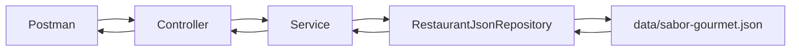

# Informe de documentación del código — Sabor Gourmet

> **Formato sugerido para Word o PDF:** Arial 12, interlineado 1,15, texto justificado. Aplicar estos estilos después de pegar el Markdown en Word.

## Portada editable

<div align="center">

**INSTITUTO PROFESIONAL IPSS**  
**Desarrollo Web II**

<br>

# Sabor Gourmet
## API REST para gestión de reservas de restaurante

<br>

**[PEGAR AQUÍ EL LOGO DE IPSS]**

<br><br>

**Estudiante:** [Nombre de la estudiante]  
**Docente:** [Nombre del docente]  
**Sección:** [Sección]  
**Fecha:** [Fecha de entrega]

</div>

---

## Índice

1. [Introducción](#1-introducción)
2. [Tecnologías y herramientas](#2-tecnologías-y-herramientas)
3. [Arquitectura y recorrido de una solicitud](#3-arquitectura-y-recorrido-de-una-solicitud)
4. [Reglas de negocio](#4-reglas-de-negocio)
5. [Documentación por archivo](#5-documentación-por-archivo)
6. [Fragmentos de código comentados](#6-fragmentos-de-código-comentados)
7. [Ejecución en Windows](#7-ejecución-en-windows)
8. [Pruebas en Postman](#8-pruebas-en-postman)
9. [Estado de verificación y pendientes](#9-estado-de-verificación-y-pendientes)
10. [Conclusiones](#10-conclusiones)

---

## 1. Introducción

Sabor Gourmet es una API REST para modernizar la gestión manual de reservas de un restaurante. La aplicación permite administrar clientes, mesas y reservas mediante solicitudes HTTP que pueden probarse con Postman, sin requerir una interfaz gráfica.

El sistema separa las responsabilidades en las capas **Controller–Service–Repository**. Los controladores reciben las solicitudes y devuelven respuestas `ResponseEntity`; los servicios aplican las reglas de negocio; y el repositorio conserva los datos en un único archivo JSON.

Una reserva relaciona un cliente y una mesa mediante `customerId` y `tableId`. Cada reserva dura 120 minutos desde `startTime`. El término no se recibe desde Postman ni se guarda como `endTime`; se calcula cada vez que se necesita comprobar vigencia o superposición.

El alcance actual incluye:

- Consultar clientes y mesas.
- Consultar mesas disponibles y reservadas por turno, por fecha o por el día actual.
- Crear, consultar, modificar y cancelar reservas.
- Actualizar la configuración de las mesas.
- Persistir clientes, mesas y reservas en `data/sabor-gourmet.json`.
- Validar referencias, capacidad, habilitación, fechas y conflictos de horario.

### Decisiones de negocio

- El restaurante admite como máximo 10 mesas.
- Una reserva confirmada dura 120 minutos.
- Una reserva cancelada permanece en el historial, pero no bloquea la mesa.
- Los turnos consecutivos se permiten cuando uno termina exactamente al comenzar el siguiente.
- `date` representa un día completo en `America/Santiago`.
- `startTime` representa un turno de 120 minutos.
- Si no se envía ninguno, las consultas de mesas usan el día calendario actual en `America/Santiago`.
- En `/tables/available` y `/tables/reserved`, enviar `date` y `startTime` juntos produce `400 Bad Request`.

---

## 2. Tecnologías y herramientas

### 2.1 Declaración comprobada en `pom.xml`

Archivo revisado: `pom.xml`.

| Tecnología | Declaración real | Uso en el proyecto |
|---|---|---|
| Lenguaje | Java 21 mediante `<java.version>21</java.version>` | Permite compilar y ejecutar la API con la versión objetivo del proyecto. |
| Framework | Spring Boot 4.1.2, heredado desde `spring-boot-starter-parent` | Configura la aplicación, el contexto y el servidor embebido. |
| API web | `spring-boot-starter-webmvc` | Proporciona Spring MVC, controladores REST, rutas HTTP y respuestas JSON. |
| Validación | `spring-boot-starter-validation` | Activa Jakarta Validation para validar cuerpos como `ReservationRequest` y `TableRequest`. |
| JSON | `spring-boot-starter-json` | Proporciona serialización y deserialización mediante Jackson. |
| Pruebas de validación | `spring-boot-starter-validation-test`, scope `test` | Dependencias de prueba para validaciones. |
| Pruebas web | `spring-boot-starter-webmvc-test`, scope `test` | Dependencias de prueba de Spring MVC. |
| Build | Plugin `spring-boot-maven-plugin` | Permite empaquetar y ejecutar la aplicación con Maven. |
| Persistencia | Archivo JSON, no una base de datos | Guarda las colecciones `customers`, `tables` y `reservations`. |

El proyecto no declara una dependencia externa para persistencia porque utiliza `ObjectMapper` y las clases estándar de Java para leer y escribir el archivo.

### 2.2 Herramientas de desarrollo y prueba

- **Visual Studio Code:** abrir, revisar y editar el proyecto.
- **Maven Wrapper:** `mvnw` para Linux/macOS y `mvnw.cmd` para Windows. La versión declarada en `.mvn/wrapper/maven-wrapper.properties` es Maven 3.10.1.
- **Postman:** enviar solicitudes HTTP y revisar estados, cuerpos JSON y persistencia.
- **Warp:** terminal usada para iniciar o reiniciar Spring Boot.
- **JDK 21:** compilar y ejecutar la aplicación.
- **Windows:** entorno donde se documenta el arranque con `mvnw.cmd`.

---

## 3. Arquitectura y recorrido de una solicitud



### Controller

Recibe la solicitud HTTP, convierte el cuerpo JSON a un modelo de entrada y aplica `@Valid` cuando corresponde. No decide si una mesa tiene capacidad ni si existe un conflicto: delega esas reglas al `Service`.

### Service

Lee los datos mediante el `Repository`, valida las reglas de negocio y decide si la operación se acepta. En una reserva verifica los IDs, la habilitación de la mesa, la capacidad, el formato y pasado de `startTime`, y la superposición con otras reservas confirmadas.

### Repository

Lee el documento completo y lo convierte en `RestaurantData`. Para una modificación, recibe una operación, actualiza una colección en memoria y vuelve a escribir el documento completo. Así se conservan las colecciones que no participaron en el cambio.

### Respuesta

El resultado vuelve por las mismas capas hasta el `Controller`, que lo envuelve en `ResponseEntity`. El estado depende de la operación: `200 OK` para consultas y actualizaciones, `201 Created` para creaciones, `204 No Content` para eliminar clientes o mesas, `400 Bad Request` para datos inválidos, `404 Not Found` para IDs inexistentes y `409 Conflict` para conflictos de negocio.

---

## 4. Reglas de negocio

### 4.1 Duración de una reserva

El cuerpo de creación y modificación solo recibe:

```json
{
  "customerId": 1,
  "tableId": 3,
  "startTime": "2026-12-01T18:00",
  "people": 2
}
```

`TimeRange.fromStart` calcula el término sumando 120 minutos. El JSON y las respuestas no incluyen `endTime`.

### 4.2 Solapamiento

Dos rangos se consideran superpuestos cuando:

```text
rangoSolicitado.inicio < rangoExistente.termino
y
rangoSolicitado.termino > rangoExistente.inicio
```

La comparación es estricta. Por ejemplo, un turno de 18:00 a 20:00 no se cruza con otro que comienza exactamente a las 20:00.

### 4.3 Disponibilidad de mesas

`GET /tables/available` solo devuelve mesas cuyo campo `available` es `true`, cuya capacidad es suficiente cuando se envía `people` y que no tienen una reserva `CONFIRMED` superpuesta con el rango consultado. Una mesa con una reserva `CANCELLED` queda disponible.

Si `people` se omite, no se aplica un filtro de capacidad. Si se envía, debe ser un entero mayor o igual a 1; `0`, valores negativos o texto no numérico producen `400 Bad Request`.

`GET /tables/reserved` parte de la colección de mesas y comprueba si alguna reserva confirmada de esa mesa se cruza con el rango. Por eso cada mesa aparece como máximo una vez.
| Endpoint | Sin parámetros | Con `date` | Con `startTime` | Con `people` | `date` + `startTime` |
|---|---|---|---|---|---|
| `/tables/available` | Día actual en `America/Santiago` | Día completo `00:00`–`00:00` siguiente | Turno de 120 minutos | Filtra `capacity >= people`; `people >= 1` | `400 Bad Request` |
| `/tables/reserved` | Día actual en `America/Santiago` | Día completo `00:00`–`00:00` siguiente | Turno de 120 minutos | No aplica | `400 Bad Request` |
| `/reservations` | Confirmadas cuyo término no pasó | Confirmadas que se cruzan con el día | No aplica | No aplica | No aplica |

### 4.4 Fechas y turnos

`date` se interpreta como un día calendario en `America/Santiago`. `startTime` se interpreta como el inicio de un turno fijo de 120 minutos. Sin ninguno de los dos parámetros, las consultas de mesas usan el día actual de Santiago.

La misma regla `TimeRange.overlaps` se usa en disponibilidad, reservas, creación y modificación. Una reserva que cruza medianoche se cruza con el rango del día de inicio y con el rango del día siguiente.

### 4.5 Campo `available` en las mesas

`TableRequest.available` es obligatorio porque tiene `@NotNull`.

- `true`: la mesa queda habilitada y puede aparecer en `/tables/available`; una reserva también puede utilizarla si cumple capacidad y horario.
- `false`: la mesa queda deshabilitada y el Service rechaza nuevas reservas para ella con `409 Conflict`.
- Campo omitido: `@Valid` produce `400 Bad Request` antes de llegar al Service.
- Valor `null`: también produce `400 Bad Request` por `@NotNull`.

Al actualizar una mesa, `available: false` guarda la mesa como deshabilitada. La implementación actual no elimina reservas existentes al cambiar este valor; conserva las referencias y evita nuevas reservas mientras la mesa esté deshabilitada.
### 4.6 Relaciones por ID

Una reserva no copia el cliente ni la mesa completos. Guarda:

- `customerId`: debe existir en `customers`.
- `tableId`: debe existir en `tables`.

Al eliminar un cliente o una mesa, el Service busca referencias en `reservations`. Si encuentra alguna, responde con `409 Conflict` y no elimina el objeto referenciado.

---

## 5. Documentación por archivo

Todas las rutas siguientes son relativas a la raíz del proyecto, es decir, la carpeta que contiene `pom.xml`.

### 5.1 Configuración y arranque

| Ruta exacta | Responsabilidad | Métodos o elementos para revisar |
|---|---|---|
| `pom.xml` | Define Java 21, Spring Boot 4.1.2, dependencias y plugin de Maven. | `<properties>`, `<dependencies>`, `spring-boot-maven-plugin`. |
| `.mvn/wrapper/maven-wrapper.properties` | Define Maven Wrapper 3.10.1. | `distributionUrl`. |
| `mvnw` | Script del Wrapper para sistemas Unix. | Script generado por Maven. |
| `mvnw.cmd` | Script del Wrapper para Windows. | Script de arranque del Wrapper. |
| `src/main/resources/application.properties` | Define el nombre de la aplicación. No fija `server.port`, por lo que Spring Boot usa el puerto predeterminado 8080. | `spring.application.name`. |
| `src/main/java/cl/ipss/sabor_gourmet/SaborGourmetApplication.java` | Punto de entrada que inicia Spring Boot. | `main(String[] args)`. |
| `HELP.md` | Ayuda generada por Spring Initializr y enlaces de referencia. | Sección `Getting Started`. |
| `AGENTS.md` | Reglas de continuidad y decisiones que deben respetarse. | Secciones de arquitectura, persistencia y API. |
| `MEMORY.md` | Estado del proyecto, verificación y pendientes para retomar el trabajo. | Secciones de estado y pruebas. |

### 5.2 Modelos

| Ruta exacta | Responsabilidad | Métodos o elementos para revisar |
|---|---|---|
| `src/main/java/cl/ipss/sabor_gourmet/model/Customer.java` | Representa un cliente persistido. | Componentes del record: `id`, `name`, `email`, `phone`. |
| `src/main/java/cl/ipss/sabor_gourmet/model/CustomerRequest.java` | Entrada para crear o actualizar clientes. | Anotaciones `@NotBlank` y `@Email`. |
| `src/main/java/cl/ipss/sabor_gourmet/model/Table.java` | Representa la configuración de una mesa. | `id`, `number`, `capacity`, `available`. |
| `src/main/java/cl/ipss/sabor_gourmet/model/TableRequest.java` | Entrada para mesas. | `@NotNull` en `number`, `capacity` y `available`; `@Min(1)` solo en `number` y `capacity`. |
| `src/main/java/cl/ipss/sabor_gourmet/model/Reservation.java` | Representa una reserva persistida. | `customerId`, `tableId`, `startTime`, `people`, `status`. |
| `src/main/java/cl/ipss/sabor_gourmet/model/ReservationRequest.java` | Entrada para crear o modificar reservas. | `customerId`, `tableId`, `startTime`, `people`; no existe `endTime`. |
| `src/main/java/cl/ipss/sabor_gourmet/model/RestaurantData.java` | Contenedor del documento JSON completo. | `getCustomers`, `getTables`, `getReservations`, setters y constructor. |

### 5.3 Controllers

| Ruta exacta | Responsabilidad | Métodos para revisar |
|---|---|---|
| `src/main/java/cl/ipss/sabor_gourmet/controller/CustomerController.java` | Expone `/customers` con `ResponseEntity`. | `getCustomers`, `getCustomer`, `createCustomer`, `updateCustomer`, `deleteCustomer`. |
| `src/main/java/cl/ipss/sabor_gourmet/controller/TableController.java` | Expone inventario, disponibilidad y configuración de mesas. | `getTables`, `getAvailableTables`, `getReservedTables`, `createTable`, `updateTable`, `deleteTable`. |
| `src/main/java/cl/ipss/sabor_gourmet/controller/ReservationController.java` | Expone consultas y operaciones de reservas. | `getCurrentReservations`, `getReservation`, `createReservation`, `updateReservation`, `cancelReservation`. |

### 5.4 Services

| Ruta exacta | Responsabilidad | Métodos para revisar |
|---|---|---|
| `src/main/java/cl/ipss/sabor_gourmet/service/CustomerService.java` | CRUD de clientes y protección de referencias. | `getAllCustomers`, `createCustomer`, `updateCustomer`, `deleteCustomer`, `nextId`. |
| `src/main/java/cl/ipss/sabor_gourmet/service/TableService.java` | CRUD de mesas, máximo de 10, capacidad y disponibilidad. | `getAvailableTables`, `getReservedTables`, `createTable`, `updateTable`, `deleteTable`, `validateActiveReservationsCapacity`. |
| `src/main/java/cl/ipss/sabor_gourmet/service/ReservationService.java` | Validaciones y operaciones de reservas. | `getReservations`, `createReservation`, `updateReservation`, `cancelReservation`, `validateReferences`, `validateTableCapacity`, `validateOverlap`. |
| `src/main/java/cl/ipss/sabor_gourmet/service/TimeRange.java` | Cálculo de intervalos, solapamiento y hora actual en Chile. | `fromStart`, `fromDate`, `resolve`, `overlaps`, `currentDate`, `currentDateTime`. |

### 5.5 Repository y errores

| Ruta exacta | Responsabilidad | Métodos para revisar |
|---|---|---|
| `src/main/java/cl/ipss/sabor_gourmet/repository/RestaurantJsonRepository.java` | Lee y actualiza el archivo JSON completo. | `read`, `update`, `write`, `normalize`. |
| `src/main/java/cl/ipss/sabor_gourmet/exception/ApiExceptionHandler.java` | Convierte excepciones en respuestas JSON con estados HTTP. | `handleValidation`, `handleBadRequest`, `handleNotFound`, `handleConflict`. |
| `src/main/java/cl/ipss/sabor_gourmet/exception/ConflictException.java` | Representa conflictos de negocio. | Constructor. |
| `src/main/java/cl/ipss/sabor_gourmet/exception/ResourceNotFoundException.java` | Representa IDs inexistentes. | Constructor. |

### 5.6 Datos y pruebas

| Ruta exacta | Responsabilidad | Métodos o elementos para revisar |
|---|---|---|
| `data/sabor-gourmet.json` | Archivo único con `customers`, `tables` y `reservations`. | Colecciones y referencias por ID. |
| `src/test/java/cl/ipss/sabor_gourmet/SaborGourmetApplicationTests.java` | Comprueba que el contexto Spring cargue. | `contextLoads`. |
| `src/test/java/cl/ipss/sabor_gourmet/TableControllerTest.java` | Comprueba respuestas directas del Controller para inventario, día actual, fechas y conflicto de parámetros. | `getTablesReturnsTablesFromJsonFile`, `currentDayWithoutParametersFindsTodaysReservation`, `dateFilterSeparatesTodayFromNovemberTwentieth`, `dateAndStartTimeCannotBeCombined`. |
| `src/test/java/cl/ipss/sabor_gourmet/TableServiceTest.java` | Comprueba límite de mesas, disponibilidad, actualización y mesas reservadas únicas. | `rejectsAnEleventhTable`, `excludesReservedTableAndKeepsExistingTableUpdatable`, `returnsEachReservedTableOnce`, `rejectsDateAndStartTimeTogether`. |
| `src/test/java/cl/ipss/sabor_gourmet/ReservationServiceTest.java` | Comprueba referencias, capacidad, solapamiento, cancelación, persistencia y filtro por fecha. | `rejectsOverlapAndPersistsCancellationWithoutLosingCollections`, `rejectsMissingReferencesAndInsufficientCapacity`, `dateFilterReturnsConfirmedReservationsThatCrossTheDay`. |

---

## 6. Fragmentos de código comentados

Los siguientes fragmentos corresponden al código actual. Las rutas se expresan desde la raíz del proyecto.

### 6.1 Controller: creación de una reserva

Ruta: `src/main/java/cl/ipss/sabor_gourmet/controller/ReservationController.java`  
Método: `createReservation`

```java
@PostMapping
public ResponseEntity<Reservation> createReservation(
        @Valid @RequestBody ReservationRequest request
) {
    Reservation reservation = reservationService.createReservation(request);
    return ResponseEntity
            .created(URI.create("/reservations/" + reservation.id()))
            .body(reservation);
}
```

El Controller recibe un JSON con `customerId`, `tableId`, `startTime` y `people`. `@Valid` ejecuta las validaciones declaradas en `ReservationRequest`. Si el cuerpo cumple la validación básica, el Controller delega el negocio a `ReservationService`. Si la operación tiene éxito, devuelve `201 Created`, una cabecera `Location` y la reserva JSON.

### 6.2 Service: creación y validaciones

Ruta: `src/main/java/cl/ipss/sabor_gourmet/service/ReservationService.java`  
Método: `createReservation`

```java
public Reservation createReservation(ReservationRequest request) {
    TimeRange range = validateStartTime(request);
    // La reserva usa siempre el turno calculado de 120 minutos desde startTime.
    return repository.update(data -> {
        validateReferences(data.getCustomers(), data.getTables(), request);
        validateTableCapacity(data.getTables(), request);
        validateOverlap(data.getReservations(), request.tableId(), range, null);

        Reservation reservation = new Reservation(
                nextId(data.getReservations()),
                request.customerId(),
                request.tableId(),
                range.start().toString(),
                request.people(),
                CONFIRMED
        );
        data.getReservations().add(reservation);
        return reservation;
    });
}
```

La validación ocurre en el Service porque no depende solo de la forma del JSON:

1. `validateStartTime` comprueba formato, calcula el término y rechaza horas pasadas.
2. `validateReferences` busca `customerId` en `customers` y `tableId` en `tables`.
3. `validateTableCapacity` comprueba que la mesa exista, esté habilitada y soporte `people`.
4. `validateOverlap` compara la nueva reserva con las reservas confirmadas de la misma mesa.
5. Solo después se agrega la reserva con estado `CONFIRMED`.

### 6.3 Repository: lectura y escritura completa

Ruta: `src/main/java/cl/ipss/sabor_gourmet/repository/RestaurantJsonRepository.java`  
Métodos: `read` y `update`

```java
public synchronized RestaurantData read() {
    try {
        return normalize(objectMapper.readValue(
                Files.readString(dataFile),
                RestaurantData.class
        ));
    } catch (IOException exception) {
        throw new IllegalStateException("Unable to read restaurant data", exception);
    }
}

public synchronized <T> T update(Function<RestaurantData, T> operation) {
    // Se conserva el documento completo: se cambia una colección y se mantienen intactas las otras.
    RestaurantData data = read();
    T result = operation.apply(data);
    write(data);
    return result;
}
```

El Repository lee `data/sabor-gourmet.json` y lo convierte en `RestaurantData`. `update` entrega el documento completo al Service, recibe la operación realizada y escribe de nuevo las tres colecciones. Por eso crear una reserva no borra clientes ni mesas.

El método `write` utiliza `TRUNCATE_EXISTING`, por lo que reemplaza el contenido con el estado actualizado. `normalize` crea listas vacías si el documento no contiene alguna colección, evitando errores por valores `null`.

### 6.4 Disponibilidad y superposición de mesas

Ruta: `src/main/java/cl/ipss/sabor_gourmet/service/TableService.java`  
Métodos: `getAvailableTables`, `getReservedTables` y `TimeRange.overlaps`

```java
public List<Table> getAvailableTables(String date, String startTime, Integer people) {
    if (people != null && people < 1) {
        throw new IllegalArgumentException("people must be greater than or equal to 1");
    }

    TimeRange requestedRange = TimeRange.resolve(date, startTime);
    var data = repository.read();
    return data.getTables().stream()
            .filter(table -> Boolean.TRUE.equals(table.available()))
            .filter(table -> people == null || table.capacity() >= people)
            .filter(table -> data.getReservations().stream()
                    .filter(reservation -> CONFIRMED.equals(reservation.status()))
                    .filter(reservation -> Objects.equals(
                            reservation.tableId(), table.id()))
                    .noneMatch(reservation -> requestedRange.overlaps(
                            TimeRange.fromStart(reservation.startTime()))))
            .toList();
}

```

El método recibe los parámetros opcionales, pero `TimeRange.resolve` siempre entrega un intervalo válido: turno, fecha completa o día actual. Luego se filtran las mesas habilitadas y se excluyen las que tienen una reserva confirmada superpuesta.

La condición compara el inicio solicitado con el término existente y el término solicitado con el inicio existente. La misma regla se utiliza al crear o modificar una reserva, evitando que las consultas y las operaciones de escritura tengan criterios distintos.

`getReservedTables` parte de las mesas, no de las reservas. Así una mesa con varias reservas superpuestas sigue apareciendo una sola vez.

### 6.5 Fechas, turnos y zona horaria

Ruta: `src/main/java/cl/ipss/sabor_gourmet/service/TimeRange.java`  
Métodos: `fromStart`, `fromDate`, `resolve`, `overlaps`, `currentDate` y `currentDateTime`

```java
private static final long RESERVATION_DURATION_MINUTES = 120;
private static final ZoneId SANTIAGO_ZONE = ZoneId.of("America/Santiago");

// El turno de una reserva comienza en startTime y termina exactamente 120 minutos después.
public static TimeRange fromStart(String startTime) {
    try {
        if (startTime == null || startTime.isBlank()) {
            throw new IllegalArgumentException("startTime is required");
        }

        LocalDateTime start = LocalDateTime.parse(startTime);
        return new TimeRange(start, start.plusMinutes(RESERVATION_DURATION_MINUTES));
    } catch (DateTimeParseException exception) {
        throw new IllegalArgumentException("startTime must use ISO format yyyy-MM-dd'T'HH:mm", exception);
    }
}

// date representa el día completo: desde la medianoche incluida hasta la medianoche siguiente excluida.
public static TimeRange fromDate(String date) {
    try {
        LocalDate day = LocalDate.parse(date);
        return new TimeRange(day.atStartOfDay(), day.plusDays(1).atStartOfDay());
    } catch (DateTimeParseException exception) {
        throw new IllegalArgumentException("date must use ISO format yyyy-MM-dd", exception);
    }
}

// Prioriza startTime cuando viene solo y rechaza la combinación ambigua de ambos parámetros.
public static TimeRange resolve(String date, String startTime) {
    if (date != null && startTime != null) {
        throw new IllegalArgumentException("date and startTime cannot be used together");
    }
    if (startTime != null) {
        return fromStart(startTime);
    }
    if (date != null) {
        return fromDate(date);
    }

    LocalDate today = currentDate();
    return fromDate(today.toString());
}
```

`fromStart` crea turnos de 120 minutos. `fromDate` crea el rango del día completo. `resolve` aplica la prioridad solicitada: rechaza ambos parámetros, conserva la consulta por turno si llega `startTime`, usa el día indicado si llega `date` y usa el día actual de Santiago si no llega ninguno.

### 6.6 Modificación y cancelación

Ruta: `src/main/java/cl/ipss/sabor_gourmet/service/ReservationService.java`  
Métodos: `updateReservation` y `cancelReservation`

```java
public Reservation updateReservation(Long id, ReservationRequest request) {
    TimeRange range = validateStartTime(request);
    return repository.update(data -> {
        int index = indexOf(data.getReservations(), id);
        Reservation existing = data.getReservations().get(index);
        if (!CONFIRMED.equals(existing.status())) {
            throw new ConflictException(
                    "Cancelled reservations cannot be modified: " + id);
        }

        validateReferences(data.getCustomers(), data.getTables(), request);
        validateTableCapacity(data.getTables(), request);
        validateOverlap(data.getReservations(), request.tableId(), range, id);
        Reservation updated = new Reservation(
                id,
                request.customerId(),
                request.tableId(),
                range.start().toString(),
                request.people(),
                CONFIRMED
        );
        data.getReservations().set(index, updated);
        return updated;
    });
}
```

Al modificar se vuelve a validar todo. `ignoredId` evita que la reserva se compare consigo misma. Una reserva cancelada no se puede modificar porque su estado ya representa el historial de la operación.

```java
public Reservation cancelReservation(Long id) {
    return repository.update(data -> {
        int index = indexOf(data.getReservations(), id);
        Reservation reservation = data.getReservations().get(index);
        if (CANCELLED.equals(reservation.status())) {
            return reservation;
        }

        Reservation cancelled = new Reservation(
                reservation.id(),
                reservation.customerId(),
                reservation.tableId(),
                reservation.startTime(),
                reservation.people(),
                CANCELLED
        );
        data.getReservations().set(index, cancelled);
        return cancelled;
    });
}
```

Cancelar no elimina el objeto. Conserva sus IDs, fecha, cantidad de personas y horario, y cambia únicamente el estado. Como las consultas de disponibilidad filtran solo `CONFIRMED`, esa mesa deja de estar bloqueada.

### 6.7 Validación y estados HTTP

Ruta: `src/main/java/cl/ipss/sabor_gourmet/exception/ApiExceptionHandler.java`  
Métodos: `handleValidation`, `handleBadRequest`, `handleNotFound`, `handleConflict`

- `MethodArgumentNotValidException`: `400 Bad Request`.
- `IllegalArgumentException` y JSON mal formado: `400 Bad Request`.
- `ResourceNotFoundException`: `404 Not Found`.
- `ConflictException`: `409 Conflict`.

El Controller se mantiene enfocado en HTTP y el Service en las reglas. El manejador central evita repetir bloques `try/catch` en cada endpoint.

---

## 7. Ejecución en Windows

### 7.1 Carpeta de ejecución

Abrir Warp o una terminal en la carpeta raíz del proyecto, la que contiene:

```text
pom.xml
mvnw.cmd
src/
data/
```

Con el proyecto ubicado en esa carpeta, ejecutar:

```bat
mvnw.cmd spring-boot:run
```

Para compilar y ejecutar las pruebas:

```bat
mvnw.cmd test
```

### 7.2 Comprobar que inició

La consola debe mostrar un mensaje de Spring Boot indicando que la aplicación inició. Como `application.properties` no define otro puerto, la API queda disponible en:

```text
http://localhost:8080
```

Una comprobación simple en Postman es:

```http
GET http://localhost:8080/tables
```

Debe responder `200 OK` con la lista de mesas.

### 7.3 Ubicación de los datos

El archivo persistente es:

```text
data/sabor-gourmet.json
```

La ruta es relativa a la carpeta desde donde se inicia la aplicación. Por eso conviene ejecutar `mvnw.cmd spring-boot:run` desde la raíz del proyecto.

---

## 8. Pruebas en Postman

### 8.1 Variables y fecha observada

Base URL sugerida:

```text
http://localhost:8080
```

En la última revisión, la fecha del sistema usada por las pruebas fue `2026-11-16` en `America/Santiago`. Si se ejecuta la prueba en otra fecha, reemplazar `2026-11-16` por la fecha actual de Santiago en las consultas sin fecha explícita. La reserva de Ana permanece en `2026-11-20`.

Body: seleccionar `raw` y `JSON` cuando se indique un cuerpo. Las respuestas no contienen `endTime`.

### 8.2 Consultar mesas del día actual

#### Mesas disponibles sin parámetros

```http
GET http://localhost:8080/tables/available
```

Body: ninguno.

Esperado:

- `200 OK`.
- Lista de mesas habilitadas sin reservas confirmadas que crucen el día actual.
- En los datos observados, la mesa `2` queda fuera porque tiene una reserva a las 20:00.

**Captura:**

> [Pegar aquí captura de Postman: mesas disponibles del día actual]

#### Mesas reservadas sin parámetros

```http
GET http://localhost:8080/tables/reserved
```

Body: ninguno.

Esperado:

- `200 OK`.
- La mesa `2` aparece una sola vez.
- Las reservas canceladas no se incluyen.

**Captura:**

> [Pegar aquí captura de Postman: mesas reservadas del día actual]

### 8.3 Consultar mesas por fecha

#### Disponibles del 16 de noviembre

```http
GET http://localhost:8080/tables/available?date=2026-11-16
```

Esperado: `200 OK`; la mesa `2` no aparece y la mesa `1` sí aparece.

#### Reservadas del 16 de noviembre

```http
GET http://localhost:8080/tables/reserved?date=2026-11-16
```

Esperado: `200 OK`; devuelve la mesa `2` una sola vez.

#### Reservadas del 20 de noviembre

```http
GET http://localhost:8080/tables/reserved?date=2026-11-20
```

Esperado: `200 OK`; devuelve la mesa `1`, correspondiente a la reserva de Ana.

La comparación entre el 16 y el 20 demuestra que la reserva de Ana no bloquea la mesa `1` durante el 16.

**Capturas:**

> [Pegar aquí captura de mesas disponibles por fecha]
>
> [Pegar aquí captura de mesas reservadas por fecha]

### 8.4 Consultar reservas por fecha

```http
GET http://localhost:8080/reservations?date=2026-11-16
```

Body: ninguno.

Esperado: `200 OK` y la reserva confirmada de la mesa `2`.

```json
[
  {
    "id": 2,
    "customerId": 2,
    "tableId": 2,
    "startTime": "2026-11-16T20:00",
    "people": 2,
    "status": "CONFIRMED"
  }
]
```

Para Ana:

```http
GET http://localhost:8080/reservations?date=2026-11-20
```

Esperado: la reserva con `id: 1`, `customerId: 1` y `tableId: 1`.

### 8.5 Consultar un turno específico

```http
GET http://localhost:8080/tables/available?startTime=2026-11-16T20:00
```

Esperado: `200 OK`; la mesa `2` queda fuera del turno de 20:00 a 22:00.

No enviar `date` junto con `startTime`:

```http
GET http://localhost:8080/tables/available?date=2026-11-16&startTime=2026-11-16T20:00
```

Esperado: `400 Bad Request` con un mensaje equivalente a:

```json
{
  "message": "date and startTime cannot be used together"
}
```

### 8.5.1 Filtro opcional por cantidad de personas

El parámetro `people` se omite para no filtrar por capacidad. Cuando se envía, debe ser un entero mayor o igual a 1 y el Service conserva solo las mesas con `capacity >= people`.

```http
GET http://localhost:8080/tables/available
GET http://localhost:8080/tables/available?people=4
GET http://localhost:8080/tables/available?date=2027-01-10&people=4
GET http://localhost:8080/tables/available?startTime=2027-01-10T18:00&people=4
GET http://localhost:8080/tables/available?people=0
```

Los cuatro primeros casos deben responder `200 OK`; el último debe responder `400 Bad Request`. Para el período futuro del ejemplo, si las mesas `3` y `4` están libres, la mesa `3` con capacidad 2 queda fuera y la mesa `4` con capacidad 4 aparece con `people=4`. La disponibilidad también exige que la mesa esté habilitada y no tenga una reserva confirmada superpuesta.

### 8.6 Crear una reserva

Usar una fecha futura respecto al día de la prueba. Con los datos actuales y la fecha observada, un ejemplo reproducible es:

```http
POST http://localhost:8080/reservations
Content-Type: application/json
```

```json
{
  "customerId": 1,
  "tableId": 3,
  "startTime": "2026-12-01T18:00",
  "people": 2
}
```

Esperado:

- `201 Created`.
- La respuesta incluye un nuevo `id`, `customerId`, `tableId`, `startTime`, `people` y `status: "CONFIRMED"`.
- No incluye `endTime`.
- El `id` devuelto se debe guardar para las pruebas de modificación y cancelación.

**Captura:**

> [Pegar aquí captura de creación exitosa]

### 8.7 Intentar una reserva superpuesta

Usar la misma mesa y un horario que se cruza con 18:00–20:00:

```http
POST http://localhost:8080/reservations
Content-Type: application/json
```

```json
{
  "customerId": 1,
  "tableId": 3,
  "startTime": "2026-12-01T19:00",
  "people": 2
}
```

Esperado:

- `409 Conflict`.
- Mensaje equivalente a `Table is already reserved in that time range: 3`.
- No se agrega una tercera reserva al JSON.

### 8.8 Modificar una reserva

Reemplazar `{id}` por el ID devuelto en la creación:

```http
PUT http://localhost:8080/reservations/{id}
Content-Type: application/json
```

```json
{
  "customerId": 1,
  "tableId": 4,
  "startTime": "2026-12-01T18:30",
  "people": 2
}
```

Esperado:

- `200 OK`.
- Se conserva el mismo ID.
- Se actualizan mesa, horario y cantidad.
- El nuevo turno vuelve a validarse antes de persistir.

**Captura:**

> [Pegar aquí captura de modificación]

### 8.9 Cancelar una reserva

```http
DELETE http://localhost:8080/reservations/{id}
```

Body: ninguno.

Esperado:

- `200 OK`.
- La respuesta conserva los datos de la reserva y cambia `status` a `CANCELLED`.
- El registro permanece en `data/sabor-gourmet.json`.
- La mesa deja de aparecer como bloqueada en las consultas de disponibilidad.

**Captura:**

> [Pegar aquí captura de cancelación]

### 8.10 Actualizar la configuración de una mesa

```http
PUT http://localhost:8080/tables/3
Content-Type: application/json
```

```json
{
  "number": 3,
  "capacity": 3,
  "available": true
}
```

Esperado:

- `200 OK`.
- La mesa conserva su `id`.
- Se actualizan número, capacidad y habilitación.
- Si se intenta reducir la capacidad por debajo de una reserva confirmada vigente, el Service responde `409 Conflict`.

**Captura:**

> [Pegar aquí captura de actualización de mesa]

### 8.11 Verificar persistencia después de reiniciar

1. Ejecutar una creación, modificación o cancelación.
2. Confirmar que la respuesta fue exitosa.
3. Detener y reiniciar Spring Boot desde Warp en la raíz del proyecto.
4. Consultar nuevamente el recurso.

Para la reserva cancelada:

```http
GET http://localhost:8080/reservations/{id}
```

Esperado: `200 OK` con el mismo ID y `status: "CANCELLED"`.

También se puede abrir directamente:

```text
data/sabor-gourmet.json
```

y verificar que el cambio se encuentre dentro de la colección correcta y que `customers`, `tables` y `reservations` sigan presentes.

**Capturas:**

> [Pegar aquí captura antes de reiniciar]
>
> [Pegar aquí captura después de reiniciar]
>
> [Pegar aquí captura del JSON persistido]

---

## 9. Estado de verificación y pendientes

### 9.1 Pruebas realizadas por la estudiante

La estudiante comprobó en Postman:

- Mesas disponibles del día en curso.
- Mesas reservadas del día en curso.
- Consultas de mesas por fecha.

Estas pruebas deben identificarse en la entrega con sus capturas correspondientes.

### 9.2 Pruebas ejecutadas por el asistente

Comando ejecutado desde la raíz del proyecto:

```bat
mvnw.cmd test
```

Resultado real:

```text
Tests run: 20
Failures: 0
Errors: 0
Skipped: 0
BUILD SUCCESS
```

También se ejecutó `mvnw.cmd -DskipTests package` y terminó con `BUILD SUCCESS`.

Se ejecutaron:

- Carga del contexto Spring Boot.
- Listado de 10 mesas desde el JSON.
- Consultas de mesas disponibles sin parámetros, con `people=4`, con `date` y `people`, y con `startTime` y `people`.
- Rechazo de `people=0` y de `date` junto con `startTime`.
- Separación de reservas del 16 y del 20 de noviembre.
- Límite de una undécima mesa.
- Disponibilidad y actualización de mesa.
- Listado único de mesas reservadas.
- Rechazo de solapamientos.
- Regla de borde: una reserva que termina a las 21:30 permite otra que comienza a las 21:30.
- Reserva que cruza medianoche visible en ambos días.
- Validación de referencias inexistentes.
- Validación de capacidad.
- Cancelación conservando las colecciones.
- Filtro de reservas por fecha.
- Flujo HTTP en copia aislada: `201` al crear, `200` al modificar, `200` al recuperar después de reiniciar y `200` al cancelar.

La prueba HTTP aislada usó el puerto `8081`, una copia temporal de `data/sabor-gourmet.json` y no alteró los datos de demostración. Estas pruebas automatizadas y HTTP fueron ejecutadas por el asistente; no reemplazan las capturas de Postman de la instancia de entrega.

### 9.3 Pruebas pendientes

- Repetir en Postman el flujo de crear, modificar, cancelar y consultar una reserva, conservando las capturas.
- Actualizar una mesa mediante Postman y documentar `available: true`, `available: false`, campo omitido y `available: null`.
- Registrar en Postman las respuestas `400`, `404` y `409` que se soliciten en la evaluación.
- Agregar capturas y completar los datos de portada.

### 9.4 Observación técnica

Las consultas y validaciones de hora actual usan `America/Santiago` mediante `TimeRange.currentDate()` y `TimeRange.currentDateTime()`. Las reservas guardan solo `startTime`; el término se calcula sumando 120 minutos. No existe una regla del enunciado para hacer únicos `Customer.email` o `Table.number`, por lo que se conserva el comportamiento actual; los IDs se generan después del mayor ID persistido.

---

## 10. Conclusiones

La aplicación cumple la separación Controller–Service–Repository y persiste las tres entidades en un único archivo JSON. Las reglas más importantes están concentradas en los servicios: la disponibilidad de mesas, la duración fija, las referencias por ID, la capacidad, los solapamientos y la cancelación conservando historial.

La documentación puede convertirse en Word o PDF aplicando Arial 12, interlineado 1,15, numeración de páginas y el logo de IPSS en la portada. Antes de entregar, completar los datos de portada, agregar las capturas de Postman y repetir las pruebas pendientes si se necesita evidencia HTTP del flujo completo.
