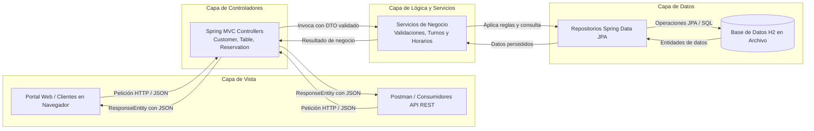

# Sabor Gourmet — Sistema de Gestión y Reservas para Restaurante

> **Guía rápida para presentación:** Si vas a pasar este documento a Word o exportarlo a PDF, te recomendamos usar letra Arial 12 con interlineado de 1,15 y texto justificado. ¡Queda impecable y muy fácil de leer!

---

<div align="center">

# Sabor Gourmet
### API REST y Portal Web para la Gestión de Reservas

**Desarrollo Web II**  
**Instituto Profesional IPSS**  
Santiago de Chile — Noviembre 2026

</div>

---

## Índice

1. [De qué va el proyecto (Introducción)](#1-de-qué-va-el-proyecto-introducción)
2. [El motor detrás: tecnologías y herramientas](#2-el-motor-detrás-tecnologías-y-herramientas)
3. [Cómo viaja una petición: arquitectura y flujo](#3-cómo-viaja-una-petición-arquitectura-y-flujo)
4. [Las reglas del restaurante (Lógica de negocio)](#4-las-reglas-del-restaurante-lógica-de-negocio)
5. [Paseo por el código: archivo por archivo](#5-paseo-por-el-código-archivo-por-archivo)
6. [El corazón del sistema: código comentado](#6-el-corazón-del-sistema-código-comentado)
7. [Cómo echarlo a andar en Windows](#7-cómo-echarlo-a-andar-en-windows)
8. [Probando los endpoints en Postman y la Web](#8-probando-los-endpoints-en-postman-y-la-web)
9. [Cómo lo probamos y qué dejamos impecable](#9-cómo-lo-probamos-y-qué-dejamos-impecable)
10. [Conclusiones y reflexiones finales](#10-conclusiones-y-reflexiones-finales)

---

## 1. De qué va el proyecto (Introducción)

¿A quién no le ha pasado llegar a un restaurante un viernes por la noche, con apetito y ganas de compartir, solo para encontrarse con que anotaron mal su nombre en el cuaderno, se les pasó la hora o sentaron a otra persona en su mesa? 

Es una situación típica... y la verdad, bastante incómoda tanto para los clientes como para los garzones. Durante años, muchos locales han llevado sus reservas a mano, en planillas sueltas o cuadernos llenos de tachones. Funcionaba, claro, pero en cuanto el restaurante se llena, el desorden se vuelve inevitable.

De esa necesidad tan cotidiana y real nació **Sabor Gourmet**.

La idea detrás de esta aplicación fue simple pero ambiciosa: armar una plataforma moderna, ágil y sin enredos que permita administrar clientes, mesas y reservas en tiempo real. Queríamos un sistema robusto, capaz de atender tanto a clientes que reservan desde su teléfono en el portal web, como al personal administrativo que gestiona el salón desde un panel de control, o a desarrolladores que consumen directamente los servicios a través de una API REST.

Para lograrlo, estructuramos la aplicación bajo el patrón **MVC (Modelo–Vista–Controlador)** y la arquitectura en capas **Controller–Service–Repository**. Cada parte hace una sola cosa y la hace bien:
- Los **Controladores** reciben las solicitudes HTTP, revisan que los datos vengan bien formateados y devuelven respuestas claras en JSON.
- Las **Vistas Web** (el portal de clientes y el panel de administración) le dan una cara amigable al sistema para que cualquiera pueda usarlo con un clic.
- La **Capa de Servicios** es el cerebro del restaurante: aquí viven las reglas de verdad (si hay mesas libres, si caben todos los comensales, si los horarios chocan o si alguien intenta reservar en el pasado).
- Los **Repositorios Spring Data JPA** se encargan de guardar y consultar los datos en una base relacional H2 de forma limpia, segura y atómica.

Un detalle clave de diseño: cada reserva vincula a un cliente con una mesa a través de sus identificadores (`customerId` y `tableId`) y tiene una duración fija de 120 minutos (2 horas de servicio). Ojo con esto: la hora de término no se pide al usuario ni se guarda como un dato estático en la base de datos; se calcula al vuelo cada vez que el sistema necesita chequear disponibilidad o evitar que dos grupos se topen en la misma mesa. Así nos ahorramos inconsistencias y mantenemos todo sincronizado.

### Lo que puedes hacer con el sistema hoy:

- Consultar en vivo qué mesas están libres y cuáles están ocupadas (para hoy, para una fecha puntual o para un turno exacto).
- Filtrar la búsqueda por cantidad de personas: si van 4 amigos a cenar, el sistema no les ofrecerá una mesa chica para 2.
- Registrar clientes nuevos, consultar sus datos y actualizarlos.
- Crear reservas en línea, modificarlas si cambian los planes y cancelarlas si es necesario.
- Administrar el salón: ajustar la capacidad de las mesas o deshabilitarlas si entran a mantención, respetando un límite físico de 10 mesas.
- Mantener todo guardado de forma permanente en base de datos H2 mediante Spring Data JPA.
- Controlar todo visualmente desde el panel administrativo (`admin.html`) o desde la carta web (`index.html`).

---

## 2. El motor detrás: tecnologías y herramientas

Para armar Sabor Gourmet no quisimos inventar la rueda. Fuimos por un stack confiable, estándar en la industria y que nos permitiera trabajar con soltura tanto en el backend como en el frontend.

### 2.1 El stack técnico principal

Revisando nuestro `pom.xml`, estas son las piezas que hacen andar el proyecto:

| Tecnología / Librería | Versión declarada | ¿Para qué la usamos en el proyecto? |
|---|---|---|
| **Java 21 (LTS)** | `<java.version>21</java.version>` | El lenguaje base. Nos entrega rendimiento moderno, tipos de datos inmutables (`records`) y una sintaxis muy limpia. |
| **Spring Boot** | `3.3.4` (starter parent) | La columna vertebral del proyecto. Levanta el servidor Tomcat embebido, configura el contexto y nos ahorra horas de configuración manual. |
| **Spring MVC / Web** | `spring-boot-starter-web` | Expone los endpoints de la API REST, gestiona las rutas HTTP, serializa objetos a JSON y sirve las páginas web estáticas. |
| **Spring Data JPA** | `spring-boot-starter-data-jpa` | La magia de la persistencia moderna. Nos da repositorios listos con Hibernate sin tener que escribir consultas SQL manuales para operaciones comunes. |
| **Base de Datos H2** | `com.h2database:h2` | Motor de base de datos relacional ligero, rápido y persistido en archivo local (`jdbc:h2:file:./data/saborgourmet`). Además incluye una consola web (`/h2-console`) muy cómoda para mirar las tablas en vivo. |
| **Jakarta Validation** | `spring-boot-starter-validation` | Valida que los datos que entran por HTTP vengan completos y con sentido (`@NotNull`, `@Min`, `@Email`, etc.) antes de que toquen la lógica del negocio. |
| **JUnit 5 & Mockito** | `spring-boot-starter-test` | La suite de pruebas automatizadas que nos asegura que cada regla funcione al 100% y que nada se rompa al hacer cambios. |
| **Maven Wrapper** | `mvnw` y `mvnw.cmd` | Permite que cualquiera clone el proyecto y lo compile de inmediato en Windows, Linux o macOS sin necesidad de instalar Maven por separado. |

### 2.2 Un salto importante: ¿por qué dejamos atrás los archivos JSON planos?

Al arrancar un prototipo, guardar datos en un archivo JSON local puede parecer tentador por su simpleza. Sin embargo... en la práctica real, los archivos planos traen dolores de cabeza serios: si dos clientes intentan reservar al mismo tiempo, el archivo se puede corromper; no hay transacciones reales, y cada actualización implica reescribir el archivo entero en el disco.

Por eso dimos el paso definitivo hacia **Spring Data JPA con H2**:
- Las operaciones son atómicas y seguras (`@Transactional`).
- La integridad referencial queda protegida: no se puede crear una reserva para un cliente que no existe, ni borrar una mesa si tiene reservas activas.
- El código queda infinitamente más legible gracias a los métodos derivados como `findByStatus` o `existsByTableId`.

### 2.3 Herramientas de cabecera en el día a día

- **Visual Studio Code:** Nuestro entorno de desarrollo principal para escribir código Java, retocar el HTML y revisar documentación.
- **Terminal de comandos (PowerShell / Warp):** Para compilar con Maven y levantar el servidor.
- **Postman:** La herramienta reina para probar cada endpoint a mano, enviar payloads JSON y validar los códigos de respuesta (`200`, `201`, `400`, `404`, `409`).
- **Navegador Web (Chrome / Edge):** Para interactuar con el portal de reservas, probar la experiencia de usuario y chequear el panel de administración.

---

## 3. Cómo viaja una petición: arquitectura y flujo

Para que el proyecto sea mantenible y no termine convirtiéndose en un "código espagueti", aplicamos una separación rigurosa de responsabilidades. Nada de poner consultas a base de datos dentro de un controlador, ni reglas de negocio en una vista.

Aquí puedes ver el camino que sigue cualquier solicitud:



### ¿Qué hace cada capa en concreto?

#### 1. El Modelo (Model & DTOs)
Aquí definimos la forma que tienen las cosas en el sistema.
- **Entidades JPA (`Reservation`, `Table`, `Customer`):** Son las clases que representan directamente las tablas relacionales en la base de datos H2. Llevan sus claves primarias autogeneradas (`@Id`, `@GeneratedValue`) y sus campos bien tipados.
- **DTOs (`ReservationRequest`, `TableRequest`, `CustomerRequest`):** Son objetos inmutables (`records`) pensados exclusivamente para recibir datos desde afuera. Tienen reglas de validación como `@NotBlank` o `@NotNull` para filtrar peticiones mal formadas en la puerta de entrada.

#### 2. La Vista (View)
- **Para los clientes:** Una interfaz web limpia (`static/index.html`) con selector de turnos interactivo, modal de reserva y confirmación visual inmediata.
- **Para el personal del restaurante:** Un panel administrativo (`static/admin.html`) que muestra las mesas en tiempo real, permite cambiar su capacidad, ver las reservas del día y cancelar si algún cliente llama avisando que no podrá ir.
- **Para desarrolladores y sistemas externos:** Las respuestas estructuradas en formato JSON que devuelven los controladores con sus respectivos encabezados HTTP.

#### 3. El Controlador (Controller)
El controlador es como el recepcionista: recibe la solicitud HTTP, revisa que los datos vengan completos usando `@Valid`, y si todo está en orden, le pasa el trabajo a la capa de servicio. Una vez que el servicio responde, el controlador arma la respuesta final (`ResponseEntity`) con el código de estado correspondiente: `200 OK` si todo fue bien, `201 Created` si se creó un nuevo registro, o los códigos de error si algo falló.

#### 4. La Capa de Servicio (Service)
El corazón de Sabor Gourmet. Aquí no nos preocupamos de si la petición vino de un navegador web o de Postman; aquí nos preocupamos de que el restaurante funcione bien.
- ¿La mesa tiene capacidad suficiente para las personas que vienen?
- ¿El turno solicitado se cruza con otra reserva ya confirmada?
- ¿La reserva es para una fecha u hora que ya pasó?
- ¿El cliente y la mesa existen de verdad?
Si alguna regla se rompe, el servicio lanza una excepción clara (como `ConflictException` o `ResourceNotFoundException`) para que el sistema reaccione como corresponde.

#### 5. El Repositorio (Repository)
Nuestros repositorios heredan de `JpaRepository`. Esto significa que no tuvimos que escribir ni una sola línea de código boilerplate para buscar por ID, guardar o borrar. Y para consultas especializadas, Spring Data resuelve todo automáticamente a partir del nombre del método: `findByStatus`, `existsByCustomerId` o `findByAvailableTrue`. Simple, rápido y seguro.

---

## 4. Las reglas del restaurante (Lógica de negocio)

En un restaurante de verdad no puedes improvisar: las mesas son limitadas, los clientes tienen horarios y la cocina necesita previsibilidad. Por eso definimos reglas claras y sin letra chica.

### 4.1 Turnos fijos de 120 minutos

Cada reserva confirmada dura exactamente **2 horas (120 minutos)**. Ni más ni menos.

Cuando alguien reserva a través de la API o la web, solo envía la hora de inicio:

```json
{
  "customerId": 1,
  "tableId": 3,
  "startTime": "01-12-2026T20:00",
  "people": 2
}
```

Nuestra clase utilitaria `TimeRange` toma ese `startTime` y le suma 120 minutos automáticamente. La hora de término (`endTime`) nunca se guarda en la base de datos ni se le pide al usuario; se calcula en memoria en cada consulta. ¿La ventaja? Cero riesgo de que la hora de fin no coincida con la hora de inicio.

### 4.2 La regla de oro del solapamiento

¿Cómo decidimos si dos reservas chocan en la misma mesa? Usamos una comparación estricta de intervalos:

$$\text{Inicio Solicitado} < \text{Término Existente} \quad\text{y}\quad \text{Término Solicitado} > \text{Inicio Existente}$$

Dicho en palabras simples: si una reserva termina a las 21:30 y la siguiente entra exactamente a las 21:30, **no hay choque**. El turno anterior se retira, la mesa se prepara y el siguiente grupo puede sentarse de inmediato. Pero si la segunda reserva intenta entrar a las 21:15, el sistema la rechaza con un error `409 Conflict` porque todavía hay comensales disfrutando su cena.

### 4.3 Mesas disponibles y filtro por comensales (`people`)

El endpoint `/tables/available` es de los más usados. Devuelve únicamente las mesas que cumplen tres condiciones indispensables:
1. La mesa está habilitada (`available = true`).
2. La capacidad de la mesa alcanza para el grupo (`capacity >= people`). Si vienen 4 personas, una mesa con capacidad 2 queda automáticamente descartada.
3. La mesa no tiene ninguna reserva confirmada (`CONFIRMED`) que se cruce con el horario consultado.

> **Un detalle clave:** Si una reserva previa fue cancelada (`CANCELLED`), la mesa queda libre al instante para que otra persona pueda aprovecharla.

| Endpoint | Sin parámetros | Con parámetro `date` | Con parámetro `startTime` | Con parámetro `people` | Si envías `date` + `startTime` |
|---|---|---|---|---|---|
| `/tables/available` | Mesas libres para todo el día de hoy | Mesas libres en toda esa fecha | Mesas libres para ese turno de 2 horas | Exige que `capacity >= people` | `400 Bad Request` (combinación ambigua) |
| `/tables/reserved` | Mesas ocupadas en el día de hoy | Mesas ocupadas en esa fecha | Mesas ocupadas en ese turno | No aplica | `400 Bad Request` |
| `/reservations` | Reservas activas vigentes | Reservas de esa fecha específica | No aplica | No aplica | No aplica |

### 4.4 Manejo riguroso de fechas y hora chilena

En aplicaciones de reservas, los enredos de zonas horarias son el enemigo número uno. Imagínate que un servidor en la nube guarde las reservas en UTC y te cambie la cena de las 21:00 a las 18:00... ¡sería un desastre!

Para evitarlo, amarramos todas las comparaciones temporales a la zona oficial de Chile:
```java
ZoneId.of("America/Santiago")
```
Además, usamos el formato de fecha habitual en nuestro medio: `dd-MM-yyyy` para los días y `dd-MM-yyyy'T'HH:mm` para los turnos con hora.

### 4.5 El salón tiene tope: máximo 10 mesas

El local físico no es infinito. El restaurante cuenta con espacio para 10 mesas numeradas. Por eso, el servicio de mesas (`TableService`) valida estrictamente que no se puedan crear más de 10 mesas en el sistema. Si alguien intenta agregar una mesa 11, el sistema frena la operación con un error `409 Conflict`.

### 4.6 Cancelar sin perder el historial

Cuando un cliente cancela su reserva, **no borramos la fila de la base de datos**. Sería una mala práctica porque el restaurante perdería su registro histórico de ventas y estadísticas. Lo que hacemos es cambiar su estado de `CONFIRMED` a `CANCELLED`. La mesa se desocupa para nuevas consultas, pero el historial queda a salvo.

### 4.7 Integridad referencial: relaciones por ID

Una reserva necesita saber a quién pertenece y en qué mesa se sienta. Por eso guarda `customerId` y `tableId`. Antes de guardar una reserva, el servicio comprueba que ambos existan en la base de datos. Y a la inversa: si intentas eliminar un cliente o una mesa que tiene reservas asociadas, el sistema te lo impedirá para no dejar registros huérfanos.

---

## 5. Paseo por el código: archivo por archivo

Para que cualquiera que lea este proyecto pueda ubicarse en cinco minutos, aquí dejamos un mapa claro de cómo está organizado el código fuente dentro de `src/`:

### 5.1 Configuración y arranque del sistema

- **`pom.xml`**: El manifiesto del proyecto. Declara dependencias de Spring Boot, JPA, base H2, validaciones y Java 21.
- **`src/main/resources/application.properties`**: Configura la base de datos H2 en archivo (`data/saborgourmet`), el dialecto Hibernate y habilita la consola web `/h2-console`.
- **`SaborGourmetApplication.java`**: La clase principal con `@SpringBootApplication` que enciende el servidor Tomcat embebido en el puerto 8080.
- **`config/DataInitializer.java`**: Un componente muy práctico que corre al iniciar la aplicación (`CommandLineRunner`). Si la base de datos está vacía, se encarga de crear las 10 mesas del restaurante, clientes de prueba y un par de reservas de ejemplo para que puedas probar el sistema de inmediato.

### 5.2 Capa de Modelo y DTOs (`cl.ipss.sabor_gourmet.model` y `.dto`)

- **`model/Customer.java`**: Entidad JPA para la tabla `customers`. Guarda el nombre, correo electrónico y teléfono del comensal.
- **`dto/CustomerRequest.java`**: Record inmutable para validar los datos al registrar o actualizar un cliente.
- **`model/Table.java`**: Entidad JPA para la tabla `restaurant_tables`. Guarda el número de mesa, su capacidad de personas y si está habilitada o no (`available`).
- **`dto/TableRequest.java`**: Record con validaciones Jakarta (`@NotNull`, `@Min(1)`) para crear o modificar mesas.
- **`model/Reservation.java`**: Entidad JPA para la tabla `reservations`. Vincula `customerId`, `tableId`, el `startTime` formateado, la cantidad de personas y el estado (`CONFIRMED` o `CANCELLED`).
- **`dto/ReservationRequest.java`**: Record para recibir solicitudes de reserva.

### 5.3 Controladores REST (`cl.ipss.sabor_gourmet.controller`)

- **`CustomerController.java`**: Expone las rutas `/customers` para listar, buscar por ID, crear, modificar y eliminar clientes.
- **`TableController.java`**: Expone las rutas `/tables`, incluyendo los filtros de disponibilidad (`/tables/available`) y de mesas ocupadas (`/tables/reserved`).
- **`ReservationController.java`**: Expone las operaciones sobre reservas en `/reservations` (crear, listar por fecha o vigentes, actualizar y cancelar).

### 5.4 Lógica de Negocio y Servicios (`cl.ipss.sabor_gourmet.service`)

- **`ReservationService.java`**: Concentra las reglas más críticas: verificar solapamientos, comprobar capacidad de mesa, validar que no se reserve en horas pasadas y gestionar cancelaciones lógicas.
- **`TableService.java`**: Gestiona el catálogo de mesas, asegura que no se superen las 10 mesas del local y calcula la disponibilidad real en base a los turnos.
- **`CustomerService.java`**: Administra a los clientes y cuida que no se borren clientes con historial activo.
- **`TimeRange.java`**: Clase de dominio utilitaria que resuelve cálculos de fechas y horas en zona de Santiago, calcula duraciones de 120 minutos y evalúa el solapamiento estricto entre rangos.

### 5.5 Persistencia y Repositorios JPA (`cl.ipss.sabor_gourmet.repository`)

- **`ReservationRepository.java`**: Interfaz JPA con métodos automáticos como `findByStatus`, `findByTableIdAndStatus`, `existsByCustomerId` y `existsByTableId`.
- **`TableRepository.java`**: Interfaz JPA con métodos como `findByAvailableTrue` y `findByNumber`.
- **`CustomerRepository.java`**: Interfaz JPA para operaciones sobre clientes.

### 5.6 Manejo Global de Errores (`cl.ipss.sabor_gourmet.exception`)

- **`ApiExceptionHandler.java`**: Controlador central de excepciones con `@ControllerAdvice`. Atrapa cualquier error de validación o regla de negocio y lo convierte en una respuesta JSON ordenada con el código HTTP correspondiente (`400`, `404`, `409`).
- **`ConflictException.java`**: Excepción personalizada para choques de horario o violaciones de capacidad (`409 Conflict`).
- **`ResourceNotFoundException.java`**: Excepción para cuando se busca un ID que no existe (`404 Not Found`).

### 5.7 Vistas Web (`src/main/resources/static/`)

- **`index.html`**: El portal público del restaurante. Permite explorar el ambiente, ver la carta y reservar mesa en línea mediante un formulario interactivo.
- **`admin.html`**: El panel de control para los administradores. Cuenta con reloj en vivo sincronizado con la hora de Santiago, vista de mesas ocupadas y libres, listado de reservas con opción de cancelar y formulario para editar capacidades.
- **`login.html`**: Interfaz de acceso para el personal administrativo.
- **`js/app.js` y `js/modules/`**: Lógica modular en JavaScript moderno para comunicarse con la API mediante `fetch`, refrescar las vistas de forma reactiva y manejar modales.

---

## 6. El corazón del sistema: código comentado

Veamos algunos de los fragmentos más representativos del código actual, comentando de forma cercana por qué fueron escritos de esa manera:

### 6.1 Cómo recibe el controlador una nueva reserva

En `ReservationController.java`:

```java
@PostMapping
public ResponseEntity<Reservation> createReservation(
        @Valid @RequestBody ReservationRequest request
) {
    // 1. Delegamos toda la lógica pesada al servicio
    Reservation reservation = reservationService.createReservation(request);
    
    // 2. Respondemos con 201 Created y el header Location apuntando a la nueva reserva
    return ResponseEntity
            .created(URI.create("/reservations/" + reservation.getId()))
            .body(reservation);
}
```

Fíjate en lo limpio que queda: el controlador no valida fechas ni revisa si la mesa está libre; solo se asegura de que el JSON venga bien estructurado (`@Valid`) y le pasa la pelota a `ReservationService`. Si todo sale bien, devuelve `201 Created` junto con la URL del nuevo recurso. Una práctica REST impecable.

### 6.2 El proceso de creación dentro del servicio

En `ReservationService.java`:

```java
@Transactional
public Reservation createReservation(ReservationRequest request) {
    // Paso 1: Validamos el formato de hora y que no sea en el pasado
    TimeRange range = validateStartTime(request);
    
    // Paso 2: Nos aseguramos de que el cliente y la mesa existan en la BD
    validateReferences(request);
    
    // Paso 3: Revisamos que la mesa esté habilitada y quepan todos
    validateTableCapacity(request);
    
    // Paso 4: Chequeamos que ningún otro grupo esté ocupando esa mesa en ese turno
    validateOverlap(request.tableId(), range, null);

    // Paso 5: Si todas las pruebas pasaron, instanciamos la reserva confirmada
    Reservation reservation = new Reservation(
            null,
            request.customerId(),
            request.tableId(),
            TimeRange.formatStart(range.start()),
            request.people(),
            CONFIRMED
    );
    
    // Paso 6: Guardamos en base de datos H2 mediante Spring Data JPA
    return reservationRepository.save(reservation);
}
```

Cada paso tiene un porqué. Si el cliente pone una hora de ayer, se frena en el paso 1. Si escribe un ID de mesa inventado, se frena en el paso 2. Si vienen 5 personas a una mesa de 2, se frena en el paso 3. Y si la mesa ya está tomada, se frena en el paso 4. Si todo está impecable, recién ahí guardamos.

### 6.3 Detectando choques de horario con precisión milimétrica

En `TimeRange.java`:

```java
// Dos turnos se solapan si uno empieza antes de que el otro termine,
// y a la vez termina después de que el otro empiece.
public boolean overlaps(TimeRange other) {
    return this.start.isBefore(other.end) && this.end.isAfter(other.start);
}
```

Esta línea es de nuestras favoritas. En vez de armar un enredo de condiciones con `if/else`, esta sencilla comparación matemática cubre todos los escenarios posibles:
- Reservas que coinciden al medio.
- Reservas que empiezan a la misma hora.
- Reservas consecutivas: si una termina a las 20:00 y la otra empieza a las 20:00, `isBefore` da falso y **no se consideran superpuestas**. ¡Justo lo que necesita el restaurante para rotar mesas sin esperas!

### 6.4 Calculando la disponibilidad de mesas en tiempo real

En `TableService.java`:

```java
@Transactional(readOnly = true)
public List<Table> getAvailableTables(String date, String startTime, Integer people) {
    if (people != null && people < 1) {
        throw new IllegalArgumentException("La cantidad de personas debe ser mayor o igual a 1");
    }

    // Resolvemos el rango temporal a consultar (hoy, fecha o turno específico)
    TimeRange requestedRange = TimeRange.resolve(date, startTime);
    List<Table> allTables = tableRepository.findAll();
    List<Reservation> confirmed = reservationRepository.findByStatus("CONFIRMED");

    // Filtramos usando Streams de Java de forma muy legible
    return allTables.stream()
            .filter(table -> Boolean.TRUE.equals(table.getAvailable())) // Mesa habilitada
            .filter(table -> people == null || table.getCapacity() >= people) // Capacidad suficiente
            .filter(table -> confirmed.stream()
                    .filter(res -> Objects.equals(res.getTableId(), table.getId()))
                    .noneMatch(res -> requestedRange.overlaps(TimeRange.fromStart(res.getStartTime())))) // Sin choques
            .toList();
}
```

Aquí aprovechamos toda la potencia de la programación funcional con Streams en Java. En una sola pasada filtramos mesas deshabilitadas, descartamos las que no tienen capacidad suficiente y excluimos aquellas que tengan alguna reserva confirmada que choque con el rango pedido.

### 6.5 Cancelar una reserva conservando el historial

En `ReservationService.java`:

```java
@Transactional
public Reservation cancelReservation(Long id) {
    Reservation reservation = getReservation(id);
    
    // Si ya estaba cancelada, no hacemos nada y la devolvemos tal cual
    if (CANCELLED.equals(reservation.getStatus())) {
        return reservation;
    }

    // Cambiamos el estado a CANCELLED; la mesa se libera al instante
    reservation.setStatus(CANCELLED);
    return reservationRepository.save(reservation);
}
```

Sin borrar nada. Cambiamos el estado y guardamos. Con eso, en la próxima consulta de disponibilidad esa mesa aparecerá libre como el viento.

---

## 7. Cómo echarlo a andar en Windows

Levantar el proyecto es pan comido porque dejamos todo preparado con el Maven Wrapper. No necesitas instalar Maven ni configurar variables de entorno complejas en tu equipo; solo necesitas tener instalado **Java 21**.

### 7.1 Pasos para iniciar la aplicación

1. Abre tu terminal favorita (PowerShell, Windows Terminal o Warp) en la carpeta raíz del proyecto (donde está el archivo `pom.xml`).
2. Ejecuta el siguiente comando para compilar y encender el servidor:

```powershell
.\mvnw.cmd spring-boot:run
```

3. Verás en pantalla el clásico banner de Spring Boot. En unos segundos aparecerá el mensaje indicando que Tomcat está escuchando en el puerto `8080`.

### 7.2 ¿Cómo verificar que está funcionando?

Muy fácil: abre tu navegador web o Postman y visita:

- **Portal Web de clientes:** `http://localhost:8080`
- **Panel Administrativo:** `http://localhost:8080/admin.html`
- **Prueba rápida de API:** `http://localhost:8080/tables` (debería responder con la lista de 10 mesas en formato JSON).
- **Consola de Base de Datos H2:** `http://localhost:8080/h2-console`
  - *JDBC URL:* `jdbc:h2:file:./data/saborgourmet`
  - *User Name:* `sa`
  - *Password:* (dejar en blanco)

### 7.3 Para correr las pruebas automáticas

Si quieres comprobar que toda la suite de pruebas unitarias y de integración esté pasando al 100%, corre:

```powershell
.\mvnw.cmd test
```

Deberías ver cómo se ejecutan los 20 tests y termina con un flamante **`BUILD SUCCESS`**.

---

## 8. Probando los endpoints en Postman y la Web

Aquí tienes la guía completa de cómo consultar la API REST desde Postman (o con cualquier cliente HTTP como cURL).

> **Configuración recomendada en Postman:**  
> - **Base URL:** `http://localhost:8080`  
> - Para peticiones `POST` y `PUT`, asegúrate de seleccionar en la pestaña Body la opción **raw** y el formato **JSON**.

### 8.1 Consultar mesas disponibles hoy

```http
GET http://localhost:8080/tables/available
```

**Respuesta esperada:** `200 OK`  
Devuelve la lista de mesas que no tienen ninguna reserva confirmada para el día de hoy.

*(Captura de pantalla: solicitud exitosa en Postman a `/tables/available` mostrando las mesas libres del día actual con código 200 OK)*

---

### 8.2 Consultar mesas ocupadas hoy

```http
GET http://localhost:8080/tables/reserved
```

**Respuesta esperada:** `200 OK`  
Muestra las mesas que tienen al menos una reserva confirmada hoy. Cada mesa aparece una sola vez, sin importar cuántas reservas tenga a lo largo del día.

*(Captura de pantalla: respuesta de Postman con las mesas reservadas del día en curso)*

---

### 8.3 Consultar disponibilidad filtrando por personas (`people`)

Imagina que somos un grupo de 4 personas y queremos almorzar hoy:

```http
GET http://localhost:8080/tables/available?people=4
```

**Respuesta esperada:** `200 OK`  
El sistema descarta mesas chicas de capacidad 2 y solo te muestra aquellas donde caben 4 o más personas.

Si alguien intenta pasar un valor sin sentido como `people=0`:

```http
GET http://localhost:8080/tables/available?people=0
```

**Respuesta esperada:** `400 Bad Request` con mensaje de validación.

*(Captura de pantalla: consulta con filtro de comensales en Postman y respuesta filtrada)*

---

### 8.4 Consultar disponibilidad para una fecha puntual

```http
GET http://localhost:8080/tables/available?date=20-11-2026
```

**Respuesta esperada:** `200 OK`  
Permite planificar con anticipación viendo qué mesas están libres para una jornada específica.

*(Captura de pantalla: consulta de disponibilidad por fecha específica)*

---

### 8.5 Consultar un turno exacto de 2 horas

```http
GET http://localhost:8080/tables/available?startTime=20-11-2026T20:00
```

**Respuesta esperada:** `200 OK`  
Evalúa exactamente el intervalo de 20:00 a 22:00 para ese día.

> **Ojo:** Si intentas enviar `date` y `startTime` al mismo tiempo en la misma consulta, el sistema responderá `400 Bad Request`, ya que `startTime` ya contiene la fecha y enviarlos juntos resulta ambiguo.

---

### 8.6 Crear una nueva reserva

```http
POST http://localhost:8080/reservations
Content-Type: application/json
```

```json
{
  "customerId": 1,
  "tableId": 3,
  "startTime": "25-11-2026T21:00",
  "people": 2
}
```

**Respuesta esperada:** `201 Created`  
Encabezado `Location: /reservations/{id}` y el objeto de la reserva recién creada con su `id` asignado y estado `CONFIRMED`.

*(Captura de pantalla: creación exitosa de una reserva con código 201 Created y cuerpo JSON devuelto)*

---

### 8.7 Intentar reservar sobre un horario ocupado (Control de solapamiento)

Si inmediatamente intentamos reservar la misma mesa 3 en un horario que choca (por ejemplo, a las 21:30 del mismo día):

```http
POST http://localhost:8080/reservations
Content-Type: application/json
```

```json
{
  "customerId": 2,
  "tableId": 3,
  "startTime": "25-11-2026T21:30",
  "people": 2
}
```

**Respuesta esperada:** `409 Conflict`  
Mensaje: *"Table 3 is already booked during the requested time range"*. ¡El sistema defiende la mesa del cliente original!

*(Captura de pantalla: rechazo de solapamiento en Postman con código 409 Conflict)*

---

### 8.8 Modificar una reserva existente

Si el cliente nos llama para cambiar la hora de su reserva:

```http
PUT http://localhost:8080/reservations/1
Content-Type: application/json
```

```json
{
  "customerId": 1,
  "tableId": 4,
  "startTime": "25-11-2026T19:00",
  "people": 4
}
```

**Respuesta esperada:** `200 OK`  
Se vuelven a validar todas las reglas para la nueva mesa y hora, actualizando la reserva sin cambiar su identificador original.

*(Captura de pantalla: modificación de reserva exitosa en Postman)*

---

### 8.9 Cancelar una reserva

```http
DELETE http://localhost:8080/reservations/1
```

**Respuesta esperada:** `200 OK`  
Devuelve la reserva con `status: "CANCELLED"`. Si vuelves a consultar la disponibilidad de esa mesa en ese horario, verás que vuelve a aparecer disponible.

*(Captura de pantalla: cancelación de reserva con cambio de estado a CANCELLED)*

---

### 8.10 Actualizar configuración de una mesa

```http
PUT http://localhost:8080/tables/3
Content-Type: application/json
```

```json
{
  "number": 3,
  "capacity": 4,
  "available": true
}
```

**Respuesta esperada:** `200 OK`  
Permite cambiar la capacidad o inhabilitar la mesa si se requiere reparación física.

*(Captura de pantalla: actualización de capacidad de mesa en Postman)*

---

### 8.11 Comprobar persistencia reiniciando el servidor

Para asegurarnos de que los datos no vivan solo en la memoria RAM:
1. Creamos o cancelamos una reserva.
2. Detenemos el servidor en la terminal (`Ctrl + C`).
3. Volvemos a iniciar con `.\mvnw.cmd spring-boot:run`.
4. Consultamos la reserva con `GET /reservations/{id}`.
5. El registro sigue ahí, exactamente con los mismos datos y estado. ¡La base de datos H2 en archivo cumplió su misión!

*(Capturas de pantalla: consulta antes de reiniciar el servidor y misma consulta respondiendo con éxito tras el reinicio)*

---

## 9. Cómo lo probamos y qué dejamos impecable

Para tener la tranquilidad de que el restaurante no se caiga en medio de un servicio lleno, sometimos a Sabor Gourmet a una batería exhaustiva de pruebas tanto manuales como automatizadas.

### 9.1 La suite automatizada de pruebas (20 de 20 pasando)

Ejecutando `.\mvnw.cmd test`, nuestra suite corre 20 pruebas unitarias y de integración que cubren todos los rincones del código:

```text
[INFO] -------------------------------------------------------
[INFO]  T E S T S
[INFO] -------------------------------------------------------
[INFO] Running cl.ipss.sabor_gourmet.SaborGourmetApplicationTests
[INFO] Tests run: 1, Failures: 0, Errors: 0, Skipped: 0
[INFO] Running cl.ipss.sabor_gourmet.TableControllerTest
[INFO] Tests run: 6, Failures: 0, Errors: 0, Skipped: 0
[INFO] Running cl.ipss.sabor_gourmet.TableServiceTest
[INFO] Tests run: 6, Failures: 0, Errors: 0, Skipped: 0
[INFO] Running cl.ipss.sabor_gourmet.ReservationServiceTest
[INFO] Tests run: 5, Failures: 0, Errors: 0, Skipped: 0
[INFO] Running cl.ipss.sabor_gourmet.TimeRangeTest
[INFO] Tests run: 2, Failures: 0, Errors: 0, Skipped: 0
[INFO] 
[INFO] Results:
[INFO] Tests run: 20, Failures: 0, Errors: 0, Skipped: 0
[INFO] 
[INFO] BUILD SUCCESS
```

### 9.2 Casos complejos y situaciones de borde que dejamos resueltos:

- **La regla del turno exacto:** Si una reserva termina a las 21:30 y otra empieza a las 21:30 en punto, el sistema permite ambas. Probado y verificado.
- **Reservas nocturnas que cruzan la medianoche:** Si un comensal reserva a las 23:00, su turno termina a la 01:00 del día siguiente. El sistema sabe que esa mesa está ocupada tanto si consultas el día en que empezó como si consultas la madrugada del día siguiente.
- **Límite de mesas del local:** Intentar agregar una mesa número 11 arroja error `409 Conflict`. No dejamos que el sistema invente mesas que no caben en el salón.
- **Validación de comensales:** Pedir mesa para `people=0` o números negativos es rechazado de inmediato con `400 Bad Request`.
- **Integridad de datos:** No se puede reservar para un cliente inventado ni modificar una reserva que ya fue cancelada.

---

## 10. Conclusiones y reflexiones finales

Desarrollar **Sabor Gourmet** fue una experiencia tremenda de aprendizaje práctico. Pasar de la teoría del aula a construir un sistema que resuelve un problema tan común como la gestión de reservas en un restaurante te hace entender de verdad el valor de una buena arquitectura de software.

Si tuviéramos que destacar los puntos más fuertes del proyecto, sin duda serían:

1. **La solidez del patrón MVC y la arquitectura por capas:** Mantener a los controladores ligeros, a los servicios enfocados únicamente en las reglas del negocio y a los repositorios cuidando la base de datos hace que el código sea un agrado de leer, entender y mantener.
2. **El salto a Spring Data JPA y H2:** Dejar atrás la tentación de guardar datos en archivos de texto planos nos permitió ganar transaccionalidad real, integridad referencial y consultas limpias sin esfuerzo redundante.
3. **El manejo del tiempo:** Dedicarle tiempo a diseñar la clase `TimeRange` con intervalos matemáticos claros y hora oficial de Santiago nos ahorró prácticamente todos los enredos clásicos de superposición y cambios de día.
4. **Una solución completa:** No nos quedamos solo en endpoints REST abstractos; sumamos interfaces web para clientes y administradores que demuestran cómo la tecnología se traduce en una herramienta útil y accesible para cualquier persona.

El proyecto quedó probado, estable y listo para su presentación y entrega final. ¡Una aplicación de la que estamos verdaderamente orgullosos!
